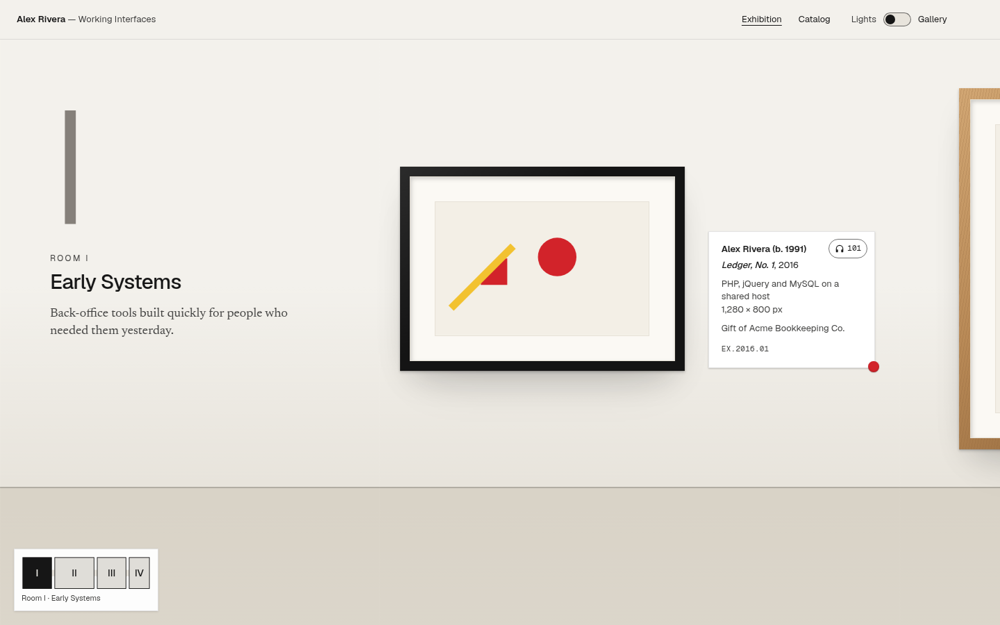

# Exhibit

A portfolio template that stages your work as a solo museum exhibition. Built with Next.js, TypeScript, Tailwind CSS, and Motion. Pages and social images are prerendered; no database, API keys, or backend service is required.



## Start locally

Use Node.js 22.18+ (or Node.js 24 LTS).

```sh
npm ci
npm run dev
```

Open [localhost:3000](http://localhost:3000). For a production preview, run `npm run build` and then `npm start`. The build downloads Geist, Newsreader, and Geist Mono through `next/font`.

## Customize in 2 minutes

1. **Your exhibition** — open [`exhibit.config.ts`](exhibit.config.ts). Change `artist`, the exhibition title and years, `site.description`, and `site.url` to your deployed URL. The latter controls canonical and social URLs. Replace the example email before accepting commissions.
2. **Your collection** — edit `rooms` and `works` in the same file. Each work's `room` must match a room ID; keep slugs unique. Titles, labels, curator notes, and UI strings all come from this config.
3. **Your images** — omit `image` for a deterministic composition seeded from the work's slug. Or place an image in `public/` and set `image: { src: "/my-work.png", alt: "Describe the work" }`. Set `size.w` and `size.h` to its proportions; choose `frame: "black" | "oak" | "white" | "none"`. `shipped: true` adds the red sticker.
4. **Your colors** — edit [`app/theme.css`](app/theme.css). `:root` defines gallery mode; `[data-lights="off"]` defines after hours. Poster and postcard colors also read the root palette, so keep their source tokens as hex colors. Recheck contrast after changing colors.
5. **Preview and publish** — run `npm run build`. Deploy to a host that supports Next.js. The poster uses the first work's generated composition; postcards use each work's supplied image or generated art.

The sample collection is fictional: its artist, clients, commissions, and works are invented. Example URLs and email addresses are placeholders. Update `ui.fictionalNotice` when replacing the collection with your own work. Technical stack and font names describe real tools.

## Routes and sharing

| Route | Purpose |
| --- | --- |
| `/` | Entrance → exhibition rooms → gift shop |
| `/opengraph-image` | 1200×630 exhibition poster: title, years, and generated artwork |
| `/works/[slug]` | Full artwork, label, curator's note, previous/next navigation |
| `/works/[slug]/opengraph-image` | 1200×630 PNG postcard, also used by the work's social preview |
| `/catalog` | Printable catalog: cover, contents, plates, and essay |

The gift shop previews and downloads those same per-work postcards. Every page supplies its title, description, canonical URL, Open Graph metadata, and Twitter large-image card through `generateMetadata`. Home and catalog share the exhibition poster. Unknown pages retain the site's defaults and are marked `noindex`.

## Visiting the gallery

- **Desktop (≥1024px):** vertical scrolling walks horizontally through the rooms. After scrolling rests for 180 ms, positions within `min(160px, 18vw)` of a room entrance gently settle there. The rest of each room scrolls freely. Floor-plan clicks, hashes, and keyboard navigation keep their chosen destination.
- **Mobile and reduced motion:** rooms stack vertically; snapping and artwork hover animation are disabled. Reduced-motion navigation jumps directly to its destination.
- **Keyboard:** Tab visits links and controls. `←` / `→` move between works; Enter opens the focused work. On a work page, arrows visit the previous/next work. `L` toggles the lights.
- **After hours:** the palette darkens and a spotlight reveals artwork. It follows the mouse, focused work, or nearest work on touch screens. Text, controls, and focus rings remain undimmed.
- **Audio guide:** numbered headphone buttons read curator notes using the browser's speech synthesis and configured language. Controls are hidden when unavailable; narration stops on navigation.
- **Floor plan:** highlights the current room; selecting a room moves to its heading.
- **Catalog:** the print button opens the browser's print dialog. Print styles restore the light palette and arrange one work per page for A4 or Letter.

## Accessibility and checks

The default palettes target WCAG AA: 4.5:1 for ordinary text, 3:1 for large text and essential control indicators. Decorative room numerals are hidden from assistive technology. Spotlight shading never covers live text or focus rings. The 375px layout reserves space for complete frames, labels, stickers, and fixed navigation.

```sh
npm test             # Room-snap proximity and boundary regressions
npm run typecheck    # TypeScript
npm run build        # Production build and static route/image generation
```

Measured default token pairs (including the pressed audio button and text selection):

| Palette | Lowest text contrast | Lowest focus color against UI surfaces |
| --- | --- | --- |
| Gallery | 5.23:1 | 5.21:1 |
| After hours | 4.86:1 | 8.06:1 |

Browser checks cover both palettes at 375×812 and desktop sizes, keyboard focus, reduced motion, room navigation, postcard downloads, and social metadata. Custom colors and longer replacement content need a fresh accessibility and layout check.

## License

[MIT](LICENSE) © 2026 Exhibit contributors.
